<picture>
  <source media="(prefers-color-scheme: dark)" srcset="assets/header-dark.svg">
  
</picture>

  
  
  

I am an Automation and Control Engineering student with experience in test engineering and industrial automation gained through a four-month internship at MACOM Technology Solutions. During my internship, I worked on automated testing systems, embedded control systems, and industrial equipment used in semiconductor manufacturing. I aim to build on this experience to develop practical automation solutions and improve manufacturing efficiency.

## Projects

<table>
<tr>
<td width="50%" valign="top">
<a href="https://github.com/Tony-Huynh-Tran/WolfSense"><b>WolfSense</b></a> 
Arduino library that connects a Flydigi Dire Wolf 3 gamepad to an ESP32 over BLE: full joystick and buttons, dead zones, auto-reconnect. 
<code>C++</code> <code>ESP32</code> <code>BLE</code>
</td>
<td width="50%" valign="top">
<a href="https://github.com/Tony-Huynh-Tran/ESP32_RTOS_Task"><b>ESP32_RTOS_Task</b></a> 
Arduino library that creates FreeRTOS tasks and thread-safe shared variables on ESP32 in one line each. 
<code>C++</code> <code>ESP32</code> <code>FreeRTOS</code>
</td>
</tr>
<tr>
<td width="50%" valign="top">
<a href="https://github.com/Tony-Huynh-Tran/Siemens-PLC-based-SCADA-solution-for-high-rise-residential-water-pumping-systems"><b>SCADA for high-rise water pumping</b></a> 
Siemens PLC controlling building water supply over Profinet with remote I/O stations and an HMI for central monitoring. 
<code>Siemens S7</code> <code>Profinet</code> <code>SCADA</code>
</td>
<td width="50%" valign="top">
<a href="https://github.com/Tony-Huynh-Tran/Hand-gesture-recognition"><b>Hand gesture recognition</b></a> 
Real-time hand gesture recognition with OpenCV, MediaPipe and a Teachable Machine model. Image processing course project. 
<code>Python</code> <code>OpenCV</code> <code>MediaPipe</code>
</td>
</tr>
<tr>
<td width="50%" valign="top">
<a href="https://github.com/Tony-Huynh-Tran/PIC16F887_Digital_Clock"><b>PIC16F887 digital clock</b></a> 
Six-digit 7-segment clock with alarm, date and temperature, from schematic to firmware. 
<code>C</code> <code>PIC16F887</code>
</td>
<td width="50%" valign="top">
<b>UR3-style 6-DOF robotic arm</b> 
Mechanical design in Fusion 360, FDM-printed prototype, stepper motor electronics, control GUI and inverse kinematics to reach target coordinates. 
<code>Fusion 360</code> <code>Robotics</code> <code>Inverse kinematics</code>
</td>
</tr>
</table>

## Tools I use

<table>
<tr>
<td valign="top"><b>Embedded</b></td>
<td>

</td>
</tr>
<tr>
<td valign="top"><b>Programming</b></td>
<td>

</td>
</tr>
<tr>
<td valign="top"><b>Vision</b></td>
<td>

</td>
</tr>
<tr>
<td valign="top"><b>Automation</b></td>
<td>

</td>
</tr>
<tr>
<td valign="top"><b>Hardware</b></td>
<td>

</td>
</tr>
</table>

## Education

**B.Eng. in Automation and Control** — Ho Chi Minh City University of Technology and Engineering (HCMUTE)  
09/2023 – expected 06/2027 · GPA **8.29/10** (latest semester 8.78/10)  
TOEIC 800 (Listening & Reading) · Scientific Research Certificate, HCMUTE
